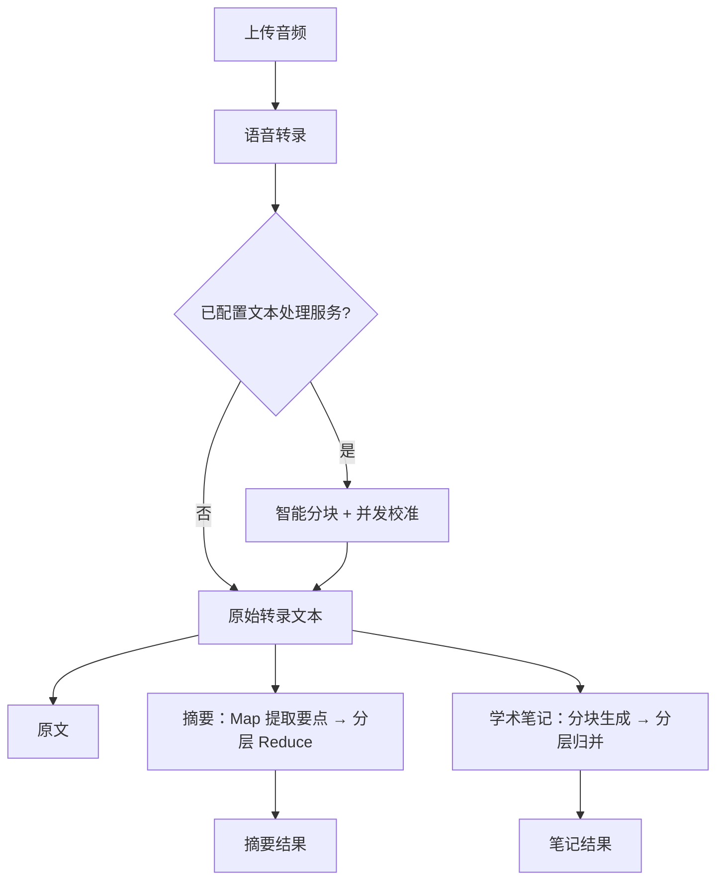

# Speech-To-Text 音频转录校准工具

> 上传一段录音，一次完成「语音转录 → 文本校准 → 摘要 / 学术笔记」。

一个基于 Flask 的轻量级语音转写工作台：接入任意 OpenAI 兼容的语音识别 API 完成转录，再调用 OpenAI 兼容的对话 API 对文本进行校准、摘要和学术笔记整理。

- 项目仓库：[Qianxia666/siliconflow-speech-to-text](https://github.com/Qianxia666/siliconflow-speech-to-text)
- 许可证：[MIT](LICENSE)

## 目录

- [功能一览](#功能一览)
- [部署指南](#部署指南)
- [配置说明](#配置说明)
- [使用指南](#使用指南)
- [API 接口](#api-接口)
- [长文本处理机制](#长文本处理机制)
- [开发与测试](#开发与测试)
- [项目结构](#项目结构)
- [常见问题](#常见问题)
- [更新日志](#更新日志)
- [许可证](#许可证)

## 功能一览

- **语音转录**：上传音频，调用兼容 OpenAI 的转录接口，返回原始文字稿。
- **文本校准**：消除停顿、重复和口语化语气词，修正错别字与多音字，同时保持原文信息完整。
- **量子速读摘要**：Map-Reduce 架构，先并发提取各段要点，再分层整合成一篇连贯的摘要。
- **学术笔记**：内置“草稿 → 自我审查 → 最终优化”三阶段提示词，长文本会先分块生成、再分层归并。
- **长文本支持**：自动分块、上下文衔接、并发处理与失败重试，避免超出模型上下文限制。
- **专用模型配置**：转录、校准、摘要、笔记可分别指定模型，互不干扰。
- **OpenAI 兼容 API**：提供 `s2t-calibrated` 与 `s2t-summarized` 两个模型，可直接接入支持 OpenAI 协议的客户端。
- **轻量 Web 界面**：原生 HTML/CSS/JS，无需前端构建，支持 Docker 部署。

> 只想拿到文字稿？只配置 `S2T_API_KEY` 即可。配置 `OPT_API_KEY` 后，校准、摘要和学术笔记功能会自动启用。

## 部署指南

即使没有部署经验，也可以按下面的顺序完成：**获取 API Key → 选择部署方式 → 跟随步骤操作 → 打开浏览器验证**。

### 先选择部署方式

| 方式 | 适合谁 | 需要安装 | 特点 |
| --- | --- | --- | --- |
| 本地运行 | 电脑上想直接运行、后续可能改代码 | Python 3.9+ | 启动快，配置稍多 |
| Docker 部署 | 不想处理 Python 环境问题 | Docker Desktop 或 Docker Engine | 环境隔离，命令更少 |

两种方式任选一种即可。下面的步骤会分别说明 Windows、macOS 和 Linux 的操作。

### 第 0 步：获取 API Key

项目需要两类 API Key，其中语音转录 Key 是必填的。

#### 语音转录 Key（必填）

本项目默认使用 SiliconFlow 的语音识别服务，也可以换成其他 OpenAI 兼容服务。

1. 打开 [SiliconFlow 控制台](https://cloud.siliconflow.cn/)，注册并登录。
2. 在控制台左侧菜单或账号设置中找到「API 密钥」。
3. 点击「新建 API 密钥」，名称可以填 `speech-to-text`。
4. 创建后立即复制密钥并妥善保存（通常以 `sk-` 开头）。
5. 如果账户余额不足，按控制台提示充值即可。

> API Key 相当于账号密码，不要发给别人，也不要上传到 GitHub。本项目已通过 `.gitignore` 忽略 `.env` 文件。

#### 文本处理 Key（可选）

如果还需要「文本校准、摘要、学术笔记」，需要再准备一个 OpenAI 兼容的对话 API。可以直接复用 SiliconFlow 的账号：

| 配置 | SiliconFlow | OpenAI |
| --- | --- | --- |
| `OPT_API_URL` | `https://api.siliconflow.cn/v1/chat/completions` | `https://api.openai.com/v1/chat/completions`（默认值） |
| `OPT_API_KEY` | 你的 SiliconFlow API Key | 你的 OpenAI API Key |
| `OPT_MODEL` | 模型广场中的对话模型 ID（如 `Qwen/Qwen2.5-7B-Instruct`，以控制台为准） | 账号可用的模型名称（如 `gpt-4o-mini`，以账号为准） |

> 不配置这部分也可以正常转录，只是不会校准、摘要和生成笔记。

### 方式一：本地运行

适用于 Windows、macOS 和 Linux。核心步骤是：安装 Python → 下载项目 → 安装依赖 → 设置环境变量 → 启动。

#### 1. 安装 Python

要求 Python 3.9 或更高版本。

**Windows**

1. 打开 [Python 官方下载页](https://www.python.org/downloads/)，下载最新的 Windows 安装包。
2. 运行安装包，务必勾选 **Add python.exe to PATH**，然后点击 **Install Now**。
3. 安装完成后，重新打开 PowerShell，输入：
   ```powershell
   python --version
   ```
   能看到 `Python 3.9` 以上的版本号即安装成功。

**macOS**

1. 打开 [Python 官方下载页](https://www.python.org/downloads/) 下载 macOS 安装包，或使用 Homebrew 安装：`brew install python`。
2. 打开「终端」，输入：
   ```bash
   python3 --version
   ```

**Linux**

1. 打开终端，先检查版本：
   ```bash
   python3 --version
   ```
2. 如果提示找不到命令，Ubuntu / Debian 可以执行：
   ```bash
   sudo apt update
   sudo apt install -y python3 python3-venv python3-pip
   ```
   其他发行版请使用对应的包管理器安装。

> Windows 使用 `python`，macOS / Linux 通常使用 `python3`。后面的命令请按你的系统选择。

#### 2. 下载项目

**已安装 Git（推荐）**

```bash
git clone https://github.com/Qianxia666/siliconflow-speech-to-text
cd siliconflow-speech-to-text
```

**没有安装 Git**

1. 打开项目仓库，点击绿色的 **Code** 按钮，选择 **Download ZIP**。
2. 解压下载的压缩包。
3. 进入解压后的文件夹，在文件夹空白处按住 **Shift** 再点右键，选择「在此处打开 PowerShell 窗口」（Windows），或在 macOS / Linux 中打开终端后 `cd` 到该文件夹。

> 后续所有命令都需要在项目文件夹中执行。如果解压后的文件夹名带 `-main`，请把 `cd` 后面的名字替换成实际文件夹名。

#### 3. 创建虚拟环境（推荐，可跳过）

虚拟环境可以避免弄乱电脑上已有的 Python 环境。如果不想创建，直接跳到第 4 步也可以。

**Windows PowerShell**

```powershell
python -m venv .venv
.\.venv\Scripts\Activate.ps1
```

如果提示「无法加载文件，因为在此系统上禁止运行脚本」，先执行下面的命令，再重新激活：

```powershell
Set-ExecutionPolicy -Scope CurrentUser -ExecutionPolicy RemoteSigned
```

也可以在传统 cmd 窗口中执行 `.\.venv\Scripts\activate.bat`。

**macOS / Linux**

```bash
python3 -m venv .venv
source .venv/bin/activate
```

激活成功后，命令行开头会出现 `(.venv)`。之后使用 `python` 或 `python3` 都可以。

#### 4. 安装依赖

```bash
python -m pip install --upgrade pip
python -m pip install -r requirements.txt
```

如果国内网络下载较慢，可以使用清华镜像：

```bash
python -m pip install -r requirements.txt -i https://pypi.tuna.tsinghua.edu.cn/simple
```

安装过程中出现大量进度条是正常的；最后没有红色报错即成功。如果未创建虚拟环境，macOS / Linux 请把 `python` 换成 `python3`。

#### 5. 设置环境变量

环境变量就是程序启动时读取的配置。最少只需要设置 `S2T_API_KEY`。

**Windows PowerShell**

```powershell
$env:S2T_API_KEY = "sk-你的语音转录密钥"

# 可选：启用文本校准、摘要与学术笔记
$env:OPT_API_URL = "https://api.siliconflow.cn/v1/chat/completions"
$env:OPT_API_KEY = "sk-你的文本处理密钥"
$env:OPT_MODEL = "Qwen/Qwen2.5-7B-Instruct"
```

**macOS / Linux**

```bash
export S2T_API_KEY="sk-你的语音转录密钥"

# 可选：启用文本校准、摘要与学术笔记
export OPT_API_URL="https://api.siliconflow.cn/v1/chat/completions"
export OPT_API_KEY="sk-你的文本处理密钥"
export OPT_MODEL="Qwen/Qwen2.5-7B-Instruct"
```

> 这样设置只对**当前终端窗口**有效，关闭窗口后需要重新设置。若希望长期保存：
>
> - Windows：在开始菜单搜索「环境变量」→「编辑系统环境变量」→「环境变量」→ 在「用户变量」中逐项新建。
> - macOS / Linux：把 `export` 语句追加到 `~/.zshrc`（macOS）或 `~/.bashrc`（Linux），再执行 `source ~/.zshrc` 或 `source ~/.bashrc`。
>
> 应用不会自动读取 `.env` 文件；`.env.example` 是配置清单，Docker 部署时才会用到。

#### 6. 启动服务

```bash
python app.py
```

启动成功时终端会显示类似内容：

```text
服务器正在启动，监听 http://0.0.0.0:5000
```

此时不要关闭终端，打开浏览器访问 <http://127.0.0.1:5000/>。需要停止服务时，在终端按 `Ctrl + C`。

想换端口可以先设置环境变量再启动，例如 Windows `$env:PORT = "8080"`、macOS / Linux `export PORT=8080`，然后访问 `http://127.0.0.1:8080/`。

### 方式二：Docker 部署

适合不想安装 Python、或希望环境更干净的情况。

#### 1. 安装 Docker

**Windows / macOS**

1. 打开 [Docker Desktop 下载页](https://www.docker.com/products/docker-desktop/)，下载并安装。
2. Windows 需要开启 WSL2 或虚拟化支持，安装向导会给出提示；安装完成后建议重启电脑。
3. 启动 Docker Desktop，等待右下角（或菜单栏）图标显示 Engine 已运行。

**Linux**

按照 [Docker Engine 官方安装文档](https://docs.docker.com/engine/install/) 安装对应发行版的版本。

安装完成后，打开终端确认：

```bash
docker --version
docker info
```

两条命令都能正常输出，说明 Docker 已就绪。

#### 2. 下载项目

```bash
git clone https://github.com/Qianxia666/siliconflow-speech-to-text
cd siliconflow-speech-to-text
```

没有 Git 时，按方式一第 2 步的「Download ZIP」方式下载并解压，然后在项目文件夹中打开终端。

#### 3. 创建并填写配置文件

先复制一份配置模板：

**Windows PowerShell**

```powershell
Copy-Item .env.example .env
```

**macOS / Linux**

```bash
cp .env.example .env
```

然后用文本编辑器打开 `.env`：

- Windows：`notepad .env`
- macOS：`open -e .env`
- Linux：`nano .env`

至少填写下面这一项：

```dotenv
S2T_API_KEY=sk-你的语音转录密钥
```

其余配置都有默认值，暂时不用修改。

需要校准、摘要和笔记时，再填写：

```dotenv
OPT_API_URL=https://api.siliconflow.cn/v1/chat/completions
OPT_API_KEY=sk-你的文本处理密钥
OPT_MODEL=Qwen/Qwen2.5-7B-Instruct
```

填写时注意：

- 每行格式为 `变量名=值`，等号两边不要留空格，值不要加引号。
- 以 `#` 开头的行是注释，不会生效。
- 保存文件后关闭编辑器，`.env` 必须放在项目文件夹根目录。

> 如果还要使用 OpenAI 兼容 API，可在 `.env` 中额外设置 `API_ACCESS_TOKEN=你的访问令牌`。完整变量见 [配置说明](#配置说明)。

#### 4. 构建镜像

```bash
docker build -t speech-to-text .
```

命令最后的 `.` 表示使用当前目录的 Dockerfile，不能省略。首次构建需要下载 Python 基础镜像并安装依赖，可能需要几分钟；看到 `Successfully tagged` 或类似提示即完成。

#### 5. 启动容器

```bash
docker run -d --name speech-to-text --env-file .env -p 5000:5000 speech-to-text
```

参数含义：

- `-d`：在后台运行，不占用当前终端。
- `--name speech-to-text`：给容器起名，方便后续管理。
- `--env-file .env`：读取刚才填写的配置。
- `-p 5000:5000`：把电脑的 5000 端口映射到容器的 5000 端口。

确认容器正在运行：

```bash
docker ps
```

状态显示 `Up` 即启动成功。查看日志：

```bash
docker logs -f speech-to-text
```

按 `Ctrl + C` 只会退出日志查看，不会停止容器。随后打开浏览器访问 <http://127.0.0.1:5000/>。

如果电脑的 5000 端口已被占用，可以改用其他本机端口，例如：

```bash
docker run -d --name speech-to-text --env-file .env -p 8080:5000 speech-to-text
```

然后访问 `http://127.0.0.1:8080/`。注意：容器内端口仍由 `PORT` 决定（默认 `5000`），`-p` 冒号前面才是电脑上的端口。

如果提示容器名已存在，先执行 `docker rm -f speech-to-text`，再重新运行 `docker run`。

> Linux 如果提示 `permission denied`，请在命令前加 `sudo`，或按 Docker 官方文档把当前用户加入 `docker` 用户组。

#### 6. 日常管理命令

| 操作 | 命令 |
| --- | --- |
| 查看运行状态 | `docker ps` |
| 查看日志 | `docker logs -f speech-to-text` |
| 停止容器 | `docker stop speech-to-text` |
| 再次启动 | `docker start speech-to-text` |
| 修改 `.env` 后重新创建 | `docker rm -f speech-to-text`，再重新执行 `docker run` |
| 更新代码后重新部署 | `git pull` → `docker build -t speech-to-text .` → 删除旧容器并重新 `docker run` |
| 删除容器 | `docker rm -f speech-to-text` |
| 删除镜像 | `docker rmi speech-to-text` |

<details>
<summary>可选：使用 Docker Compose 管理</summary>

在项目文件夹中新建 `docker-compose.yml`：

```yaml
services:
  speech-to-text:
    build: .
    container_name: speech-to-text
    env_file:
      - .env
    ports:
      - "5000:5000"
    restart: unless-stopped
```

然后执行：

```bash
docker compose up -d --build   # 构建并启动
docker compose logs -f         # 查看日志
docker compose down            # 停止并删除
```

</details>

### 最后一步：验证部署

1. 浏览器打开 <http://127.0.0.1:5000/>，能看到「声稿 · 音频转录工作台」页面。
2. 左侧「处理能力」会显示四项服务的状态。只配置了 `S2T_API_KEY` 时，「语音转录」为可用，其余为未配置。
3. 在浏览器打开 <http://127.0.0.1:5000/healthz>，正常返回类似：

```json
{
  "status": "ok",
  "s2t_configured": true,
  "optimization_configured": true,
  "calibration_configured": true,
  "summary_configured": true,
  "notes_configured": true,
  "max_upload_mb": 100,
  "max_text_chars": 250000
}
```

4. 选择一段较短的音频（建议先用 1 分钟以内的文件），点击「开始转录」。右侧出现文字即部署成功。

如果 `s2t_configured` 为 `false`，说明转录 Key 或地址没有配置正确；如果 `calibration_configured` 等为 `false`，说明文本处理配置缺失，但不影响转录。

### 停止与再次启动

- 本地运行：在运行 `python app.py` 的终端按 `Ctrl + C` 停止。再次启动前需要重新设置环境变量（如果之前没有做长期配置）。
- Docker：执行 `docker stop speech-to-text` 停止，`docker start speech-to-text` 再次启动。
- 修改 `.env` 后，Docker 容器不会自动读取新配置，需要删除旧容器并重新创建。

## 配置说明

所有配置均通过环境变量注入。本地运行时在终端设置；Docker 部署时填写在 `.env` 文件中。完整示例见 [.env.example](.env.example)。

### 语音转录

| 变量 | 必需 | 默认值 | 说明 |
| --- | --- | --- | --- |
| `S2T_API_KEY` | 是 | — | 语音转录服务的 API Key；未设置时转录接口返回 `503` |
| `S2T_API_URL` | 否 | `https://api.siliconflow.cn/v1/audio/transcriptions` | 兼容 OpenAI 的音频转录端点 |
| `S2T_MODEL` | 否 | `FunAudioLLM/SenseVoiceSmall` | 转录模型名称 |

### 文本处理（校准 / 摘要 / 学术笔记）

| 变量 | 必需 | 默认值 | 说明 |
| --- | --- | --- | --- |
| `OPT_API_KEY` | 否 | — | Chat Completions 服务的 API Key；未设置时跳过校准，摘要与笔记接口返回配置不可用 |
| `OPT_API_URL` | 否 | `https://api.openai.com/v1/chat/completions` | 兼容 OpenAI 的对话端点 |
| `OPT_MODEL` | 否 | — | 默认文本处理模型；下方三个专用变量未设置时使用它 |
| `CALIBRATION_MODEL` | 否 | 继承 `OPT_MODEL` | 文本校准专用模型 |
| `SUMMARY_MODEL` | 否 | 继承 `OPT_MODEL` | 摘要生成专用模型 |
| `NOTES_MODEL` | 否 | 继承 `OPT_MODEL` | 学术笔记专用模型 |

> 使用 OpenAI 官方接口时必须显式设置 `OPT_MODEL`；使用其他兼容服务时，请填写该服务提供的模型名称。

### OpenAI 兼容 API

| 变量 | 必需 | 默认值 | 说明 |
| --- | --- | --- | --- |
| `API_ACCESS_TOKEN` | 否 | — | `/v1/*` 接口的 Bearer Token；未设置时这些接口返回 `503` |

### 运行与性能参数

| 变量 | 必需 | 默认值 | 说明 |
| --- | --- | --- | --- |
| `PORT` | 否 | `5000` | 服务监听端口（`1`–`65535`） |
| `MAX_UPLOAD_MB` | 否 | `100` | 单个音频上传上限，单位 MB（`1`–`1024`） |
| `MAX_TEXT_CHARS` | 否 | `250000` | 单次文本处理字符上限（`1000`–`5000000`） |
| `API_TIMEOUT_SECONDS` | 否 | `300` | 上游请求超时时间，单位秒（`5`–`1800`） |
| `RETRY_ATTEMPTS` | 否 | `3` | 上游失败重试次数（`1`–`10`） |
| `RETRY_BACKOFF_SECONDS` | 否 | `2` | 线性退避基数，单位秒（`1`–`60`） |
| `CHUNK_TARGET_SIZE` | 否 | `5000` | 长文本分块目标长度（`500`–`50000`） |
| `CHUNK_PROCESSING_THRESHOLD` | 否 | `5500` | 超过该长度才启用分块处理，不会小于 `CHUNK_TARGET_SIZE` |
| `MAX_CONCURRENT_WORKERS` | 否 | `3` | 分块并发线程数（`1`–`16`） |

## 使用指南

### Web 界面

1. 选择或拖入音频文件（界面提示支持 MP3、WAV、M4A、FLAC，实际上限取决于上游服务）。
2. 点击「开始转录」，等待原始转录与校准完成。
3. 在右侧工作区切换「原文 / 摘要 / 笔记」，可复制结果，或按需重新校准、重新生成摘要、重新生成笔记。

左侧「处理能力」会显示四项服务的配置状态，未配置的功能按钮会自动禁用。

### 典型场景

- **会议记录**：转录 + 校准，再一键生成摘要。
- **讲座 / 课程整理**：转录 + 校准，再生成结构化学术笔记。
- **快速出稿**：仅配置 `S2T_API_KEY`，直接获取原始文字稿。

> **安全提示**：Web 页面与 `/api/*` 接口未内置登录鉴权。如需公网访问，请通过反向代理、访问控制或仅监听内网地址来保护；`/v1/*` 接口由 `API_ACCESS_TOKEN` 保护。

## API 接口

### 页面与健康检查

| 方法 | 路径 | 说明 |
| --- | --- | --- |
| `GET` | `/` | Web 界面 |
| `GET` | `/healthz` | 返回服务状态、各能力配置状态及当前上限 |

### Web UI 内部接口

以下接口供自带页面使用，请求与响应均为 JSON（转录接口除外）。

| 方法 | 路径 | 请求体 | 说明 |
| --- | --- | --- | --- |
| `POST` | `/api/transcribe` | `multipart/form-data`，字段 `audio_file` | 上传音频并返回原始转录、校准文本 |
| `POST` | `/api/recalibrate` | `{"raw_transcription": "..."}` | 重新校准指定文本 |
| `POST` | `/api/summarize` | `{"text_to_summarize": "..."}` | 生成摘要，返回 `{"summary": "..."}` |
| `POST` | `/api/generatenote` | `{"text_to_process": "..."}` | 生成学术笔记，返回 `{"status": "success", "notes": "..."}` |

`/api/transcribe` 返回示例：

```json
{
  "status": "success",
  "transcription": "校准后的文本",
  "raw_transcription": "原始转录文本",
  "calibration_message": "转录完成，校准成功！",
  "is_calibrated": true
}
```

校准失败时会回退为原始转录文本，并在 `calibration_message` 中说明原因。

### OpenAI 兼容接口

设置 `API_ACCESS_TOKEN` 后，可将本服务当作 OpenAI 兼容的音频转录端点使用。

| 模型 | 作用 |
| --- | --- |
| `s2t-calibrated` | 音频 → 校准后的文本 |
| `s2t-summarized` | 音频 → 校准后的文本 → 摘要 |

- `GET /v1/models`：列出上述两个模型
- `POST /v1/audio/transcriptions`：上传音频并转录
- 认证方式：`Authorization: Bearer <API_ACCESS_TOKEN>`

请求字段：

| 字段 | 必需 | 说明 |
| --- | --- | --- |
| `file` | 是 | 音频文件 |
| `model` | 是 | `s2t-calibrated` 或 `s2t-summarized` |
| `response_format` | 否 | `json`（默认）、`text` 或 `verbose_json`；`text` 返回纯文本，其余返回 JSON |

示例：

```bash
curl http://127.0.0.1:5000/v1/audio/transcriptions \
  -H "Authorization: Bearer $API_ACCESS_TOKEN" \
  -F "file=@meeting.m4a" \
  -F "model=s2t-calibrated"
```

```json
{
  "text": "校准后的文本"
}
```

当校准或摘要失败但仍有可用文本时，接口会返回最佳可用结果，并附带 `x_warning` 说明失败原因。

在第三方客户端中配置时：

- Base URL：`http://<host>:5000/v1`
- API Key：`API_ACCESS_TOKEN` 的值
- 模型：`s2t-calibrated` 或 `s2t-summarized`

错误响应统一为 OpenAI 风格：

```json
{
  "error": {
    "message": "Incorrect API key provided.",
    "type": "invalid_request_error"
  }
}
```

## 长文本处理机制



- **语义分块**：超过 `CHUNK_PROCESSING_THRESHOLD` 的文本会按句号、问号、感叹号、分号、换行等边界切分，目标长度由 `CHUNK_TARGET_SIZE` 控制，不丢失任何字符。
- **上下文衔接**：校准每个分块时，会把前一块的最后一句作为上下文提示，减少分段造成的语气与风格断裂。
- **并发处理**：各分块通过线程池并行处理，并发数由 `MAX_CONCURRENT_WORKERS` 控制。
- **自动重试**：上游超时、连接错误及 `408/425/429/500/502/503/504` 等可重试状态会自动重试，采用线性退避；单个分块失败时，校准整体回退到原始文本，避免输出残缺内容。
- **分层归并**：摘要与笔记的 Reduce 阶段会按需逐层合并，确保每次请求都不超过分块长度限制。
- **上限保护**：超过 `MAX_TEXT_CHARS` 的文本会被拒绝处理；转录文本超限时会跳过校准，仍返回原始转录。

## 开发与测试

```bash
# 安装开发依赖（含 requirements.txt）
python -m pip install -r requirements-dev.txt

# 语法检查
python -m compileall -q app.py tests

# 后端单元测试
python -m unittest discover -v

# 前端逻辑测试（需要 Node.js 18+）
node --test tests/frontend.test.mjs

# 代码风格检查
ruff check .
ruff format --check .
```

测试中的上游请求均使用 mock，不会调用真实 API，也不需要配置密钥。

前端为原生 HTML/CSS/JavaScript，没有构建步骤，修改 `templates/` 与 `static/` 后刷新页面即可生效。

## 项目结构

```text
.
├── app.py                  # Flask 应用：路由与转录、校准、摘要、笔记处理
├── templates/
│   └── index.html          # Web 界面模板
├── static/
│   ├── script.js           # 前端交互逻辑
│   ├── style.css           # 样式
│   └── favicon.svg         # 站点图标
├── tests/
│   ├── test_app.py         # 后端单元测试
│   └── frontend.test.mjs   # 前端逻辑测试
├── .env.example            # 环境变量示例
├── Dockerfile
├── requirements.txt
├── requirements-dev.txt
└── ruff.toml
```

## 常见问题

### 部署与启动

**输入 `python` 提示「不是内部或外部命令」怎么办？**

Windows 安装 Python 时没有勾选 **Add python.exe to PATH**。重新运行安装包，选择 Modify，勾选该选项；或者卸载后重新安装并勾选。安装完成后必须重新打开终端。

**PowerShell 提示「禁止运行脚本」，虚拟环境无法激活怎么办？**

执行：

```powershell
Set-ExecutionPolicy -Scope CurrentUser -ExecutionPolicy RemoteSigned
```

然后重新激活虚拟环境。也可以跳过虚拟环境，直接安装依赖并运行。

**`pip install` 很慢或超时怎么办？**

使用国内镜像：

```bash
python -m pip install -r requirements.txt -i https://pypi.tuna.tsinghua.edu.cn/simple
```

**启动时提示端口被占用怎么办？**

本地运行可以设置 `PORT=8080` 后重启；Docker 可以改用 `-p 8080:5000`，然后访问 `http://127.0.0.1:8080/`。

**修改 `.env` 后 Docker 没有生效？**

运行中的容器不会重新读取 `.env`。执行 `docker rm -f speech-to-text` 删除旧容器，再重新执行 `docker run`。

**Docker 构建时卡在拉取镜像怎么办？**

先确认网络能够访问 Docker Hub，或检查 Docker Desktop 的代理 / 镜像加速器设置。也可以改用本地 Python 方式运行。

**Docker 提示 `permission denied` 怎么办？**

Linux 下在命令前加 `sudo`，或按 Docker 文档把当前用户加入 `docker` 用户组后重新登录。

### 使用问题

**没有 `OPT_API_KEY` 还能用吗？**

可以。转录仍会正常返回原始文本，只是跳过校准；摘要与笔记接口会返回配置不可用的错误，前端对应按钮也会禁用。

**支持哪些音频格式和大小？**

格式由上游语音识别服务决定，界面支持常见音频类型（MP3、WAV、M4A、FLAC 等）。默认单文件上限为 100 MB，可通过 `MAX_UPLOAD_MB` 调整。

**页面能打开，但点击转录后报错？**

先检查运行终端或 `docker logs` 中的错误信息，再确认 `S2T_API_KEY` 是否填写正确、账户是否有余额。也可以打开 `/healthz` 查看 `s2t_configured` 是否为 `true`。

**校准、摘要或笔记按钮是灰色的？**

对应服务没有配置完整。检查 `OPT_API_KEY`、`OPT_API_URL`、`OPT_MODEL`（或对应的专用模型变量），并查看 `/healthz` 中的配置状态。

**调用 `/v1/*` 返回 `503 API access is not configured`？**

说明服务端没有设置 `API_ACCESS_TOKEN`。配置该变量并重启服务后即可使用 OpenAI 兼容接口。

**长文本被拒绝处理？**

单次文本上限由 `MAX_TEXT_CHARS` 控制（默认 250,000 字符）。调大前请评估所使用模型的上下文窗口与服务器内存。

## 更新日志

- **2025-08-29**：新增学术笔记生成（三阶段处理），支持为转录、校准、摘要、笔记分别配置专用模型。
- **2025-06-09**：新增 OpenAI 兼容 API（`s2t-calibrated` / `s2t-summarized`），并重构路由命名空间。
- **2025-06-07**：新增「量子速读」一键摘要，支持原文 / 摘要切换。
- **2025-06-06**：引入自动分块、上下文感知、并发校准与自动重试机制。

## 许可证

[MIT License](LICENSE) © Qianxia666
