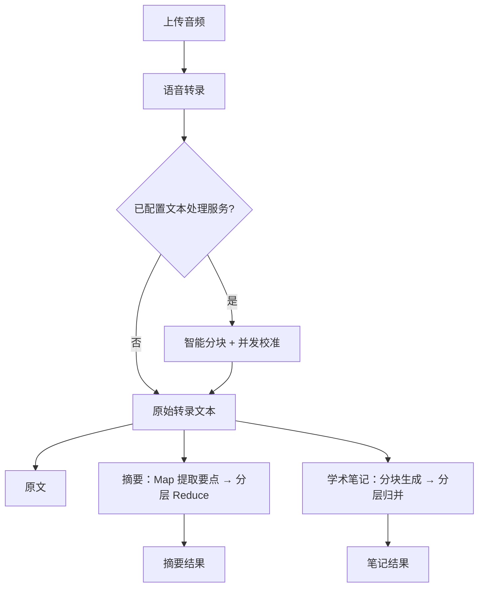

# Speech-To-Text 音频转录校准工具

> 上传一段录音，一次完成「语音转录 → 文本校准 → 摘要 / 学术笔记」。

一个基于 Flask 的轻量级语音转写工作台：接入任意 OpenAI 兼容的语音识别 API 完成转录，再调用 OpenAI 兼容的对话 API 对文本进行校准、摘要和学术笔记整理。

- 项目仓库：[Qianxia666/siliconflow-speech-to-text](https://github.com/Qianxia666/siliconflow-speech-to-text)
- 许可证：[MIT](LICENSE)

## 目录

- [功能一览](#功能一览)
- [快速开始](#快速开始)
- [配置说明](#配置说明)
- [使用指南](#使用指南)
- [API 接口](#api-接口)
- [长文本处理机制](#长文本处理机制)
- [开发与测试](#开发与测试)
- [项目结构](#项目结构)
- [常见问题](#常见问题)
- [更新日志](#更新日志)
- [许可证](#许可证)

## 功能一览

- **语音转录**：上传音频，调用兼容 OpenAI 的转录接口，返回原始文字稿。
- **文本校准**：消除停顿、重复和口语化语气词，修正错别字与多音字，同时保持原文信息完整。
- **量子速读摘要**：Map-Reduce 架构，先并发提取各段要点，再分层整合成一篇连贯的摘要。
- **学术笔记**：内置“草稿 → 自我审查 → 最终优化”三阶段提示词，长文本会先分块生成、再分层归并。
- **长文本支持**：自动分块、上下文衔接、并发处理与失败重试，避免超出模型上下文限制。
- **专用模型配置**：转录、校准、摘要、笔记可分别指定模型，互不干扰。
- **OpenAI 兼容 API**：提供 `s2t-calibrated` 与 `s2t-summarized` 两个模型，可直接接入支持 OpenAI 协议的客户端。
- **轻量 Web 界面**：原生 HTML/CSS/JS，无需前端构建，支持 Docker 部署。

> 只想拿到文字稿？只配置 `S2T_API_KEY` 即可。配置 `OPT_API_KEY` 后，校准、摘要和学术笔记功能会自动启用。

## 快速开始

### 环境要求

- Python 3.9+，或 Docker
- 一个 OpenAI 兼容的语音识别 API Key（必需）
- 一个 OpenAI 兼容的 Chat Completions API Key（可选，用于文本处理）

### 本地运行

```bash
# 1. 安装依赖
python -m pip install -r requirements.txt

# 2. 配置环境变量（最简：只启用转录）
export S2T_API_KEY="sk-your-s2t-key"

# 可选：启用校准、摘要与学术笔记
export OPT_API_URL="https://api.openai.com/v1/chat/completions"
export OPT_API_KEY="sk-your-opt-key"
export OPT_MODEL="gpt-4o-mini"

# 3. 启动
python app.py
```

启动后访问 <http://127.0.0.1:5000/>。

> 应用不会自动读取 `.env` 文件。`.env.example` 是完整的配置清单；本地运行时请通过 shell 或进程管理工具注入环境变量，Docker 可直接使用 `--env-file`。

### Docker 部署

```bash
cp .env.example .env   # 填写 S2T_API_KEY 等配置
docker build -t speech-to-text .

docker run -d --name speech-to-text \
  --env-file .env \
  -p 5000:5000 \
  speech-to-text
```

如果修改了 `.env` 中的 `PORT`，请同步调整端口映射，例如 `PORT=8080` 时使用 `-p 8080:8080`。容器健康检查会自动跟随该端口。

<details>
<summary>使用 Docker Compose</summary>

```yaml
services:
  speech-to-text:
    build: .
    container_name: speech-to-text
    env_file:
      - .env
    ports:
      - "5000:5000"
    restart: unless-stopped
```

```bash
docker compose up -d --build
```

</details>

### 验证服务

```bash
curl -s http://127.0.0.1:5000/healthz
```

返回示例：

```json
{
  "status": "ok",
  "s2t_configured": true,
  "optimization_configured": true,
  "calibration_configured": true,
  "summary_configured": true,
  "notes_configured": true,
  "max_upload_mb": 100,
  "max_text_chars": 250000
}
```

`*_configured` 字段表示对应能力是否已正确配置；即使某项为 `false`，服务本身仍会正常启动。

## 配置说明

所有配置均通过环境变量注入，完整示例见 [.env.example](.env.example)。

### 语音转录

| 变量 | 必需 | 默认值 | 说明 |
| --- | --- | --- | --- |
| `S2T_API_KEY` | 是 | — | 语音转录服务的 API Key；未设置时转录接口返回 `503` |
| `S2T_API_URL` | 否 | `https://api.siliconflow.cn/v1/audio/transcriptions` | 兼容 OpenAI 的音频转录端点 |
| `S2T_MODEL` | 否 | `FunAudioLLM/SenseVoiceSmall` | 转录模型名称 |

### 文本处理（校准 / 摘要 / 学术笔记）

| 变量 | 必需 | 默认值 | 说明 |
| --- | --- | --- | --- |
| `OPT_API_KEY` | 否 | — | Chat Completions 服务的 API Key；未设置时跳过校准，摘要与笔记接口返回配置不可用 |
| `OPT_API_URL` | 否 | `https://api.openai.com/v1/chat/completions` | 兼容 OpenAI 的对话端点 |
| `OPT_MODEL` | 否 | — | 默认文本处理模型；下方三个专用变量未设置时使用它 |
| `CALIBRATION_MODEL` | 否 | 继承 `OPT_MODEL` | 文本校准专用模型 |
| `SUMMARY_MODEL` | 否 | 继承 `OPT_MODEL` | 摘要生成专用模型 |
| `NOTES_MODEL` | 否 | 继承 `OPT_MODEL` | 学术笔记专用模型 |

> 使用 OpenAI 官方接口时必须显式设置 `OPT_MODEL`；使用其他兼容服务时，请填写该服务提供的模型名称。

### OpenAI 兼容 API

| 变量 | 必需 | 默认值 | 说明 |
| --- | --- | --- | --- |
| `API_ACCESS_TOKEN` | 否 | — | `/v1/*` 接口的 Bearer Token；未设置时这些接口返回 `503` |

### 运行与性能参数

| 变量 | 必需 | 默认值 | 说明 |
| --- | --- | --- | --- |
| `PORT` | 否 | `5000` | 服务监听端口（`1`–`65535`） |
| `MAX_UPLOAD_MB` | 否 | `100` | 单个音频上传上限，单位 MB（`1`–`1024`） |
| `MAX_TEXT_CHARS` | 否 | `250000` | 单次文本处理字符上限（`1000`–`5000000`） |
| `API_TIMEOUT_SECONDS` | 否 | `300` | 上游请求超时时间，单位秒（`5`–`1800`） |
| `RETRY_ATTEMPTS` | 否 | `3` | 上游失败重试次数（`1`–`10`） |
| `RETRY_BACKOFF_SECONDS` | 否 | `2` | 线性退避基数，单位秒（`1`–`60`） |
| `CHUNK_TARGET_SIZE` | 否 | `5000` | 长文本分块目标长度（`500`–`50000`） |
| `CHUNK_PROCESSING_THRESHOLD` | 否 | `5500` | 超过该长度才启用分块处理，不会小于 `CHUNK_TARGET_SIZE` |
| `MAX_CONCURRENT_WORKERS` | 否 | `3` | 分块并发线程数（`1`–`16`） |

## 使用指南

### Web 界面

1. 选择或拖入音频文件（界面提示支持 MP3、WAV、M4A、FLAC，实际上限取决于上游服务）。
2. 点击「开始转录」，等待原始转录与校准完成。
3. 在右侧工作区切换「原文 / 摘要 / 笔记」，可复制结果，或按需重新校准、重新生成摘要、重新生成笔记。

左侧「处理能力」会显示四项服务的配置状态，未配置的功能按钮会自动禁用。

### 典型场景

- **会议记录**：转录 + 校准，再一键生成摘要。
- **讲座 / 课程整理**：转录 + 校准，再生成结构化学术笔记。
- **快速出稿**：仅配置 `S2T_API_KEY`，直接获取原始文字稿。

> **安全提示**：Web 页面与 `/api/*` 接口未内置登录鉴权。如需公网访问，请通过反向代理、访问控制或仅监听内网地址来保护；`/v1/*` 接口由 `API_ACCESS_TOKEN` 保护。

## API 接口

### 页面与健康检查

| 方法 | 路径 | 说明 |
| --- | --- | --- |
| `GET` | `/` | Web 界面 |
| `GET` | `/healthz` | 返回服务状态、各能力配置状态及当前上限 |

### Web UI 内部接口

以下接口供自带页面使用，请求与响应均为 JSON（转录接口除外）。

| 方法 | 路径 | 请求体 | 说明 |
| --- | --- | --- | --- |
| `POST` | `/api/transcribe` | `multipart/form-data`，字段 `audio_file` | 上传音频并返回原始转录、校准文本 |
| `POST` | `/api/recalibrate` | `{"raw_transcription": "..."}` | 重新校准指定文本 |
| `POST` | `/api/summarize` | `{"text_to_summarize": "..."}` | 生成摘要，返回 `{"summary": "..."}` |
| `POST` | `/api/generatenote` | `{"text_to_process": "..."}` | 生成学术笔记，返回 `{"status": "success", "notes": "..."}` |

`/api/transcribe` 返回示例：

```json
{
  "status": "success",
  "transcription": "校准后的文本",
  "raw_transcription": "原始转录文本",
  "calibration_message": "转录完成，校准成功！",
  "is_calibrated": true
}
```

校准失败时会回退为原始转录文本，并在 `calibration_message` 中说明原因。

### OpenAI 兼容接口

设置 `API_ACCESS_TOKEN` 后，可将本服务当作 OpenAI 兼容的音频转录端点使用。

| 模型 | 作用 |
| --- | --- |
| `s2t-calibrated` | 音频 → 校准后的文本 |
| `s2t-summarized` | 音频 → 校准后的文本 → 摘要 |

- `GET /v1/models`：列出上述两个模型
- `POST /v1/audio/transcriptions`：上传音频并转录
- 认证方式：`Authorization: Bearer <API_ACCESS_TOKEN>`

请求字段：

| 字段 | 必需 | 说明 |
| --- | --- | --- |
| `file` | 是 | 音频文件 |
| `model` | 是 | `s2t-calibrated` 或 `s2t-summarized` |
| `response_format` | 否 | `json`（默认）、`text` 或 `verbose_json`；`text` 返回纯文本，其余返回 JSON |

示例：

```bash
curl http://127.0.0.1:5000/v1/audio/transcriptions \
  -H "Authorization: Bearer $API_ACCESS_TOKEN" \
  -F "file=@meeting.m4a" \
  -F "model=s2t-calibrated"
```

```json
{
  "text": "校准后的文本"
}
```

当校准或摘要失败但仍有可用文本时，接口会返回最佳可用结果，并附带 `x_warning` 说明失败原因。

在第三方客户端中配置时：

- Base URL：`http://<host>:5000/v1`
- API Key：`API_ACCESS_TOKEN` 的值
- 模型：`s2t-calibrated` 或 `s2t-summarized`

错误响应统一为 OpenAI 风格：

```json
{
  "error": {
    "message": "Incorrect API key provided.",
    "type": "invalid_request_error"
  }
}
```

## 长文本处理机制



- **语义分块**：超过 `CHUNK_PROCESSING_THRESHOLD` 的文本会按句号、问号、感叹号、分号、换行等边界切分，目标长度由 `CHUNK_TARGET_SIZE` 控制，不丢失任何字符。
- **上下文衔接**：校准每个分块时，会把前一块的最后一句作为上下文提示，减少分段造成的语气与风格断裂。
- **并发处理**：各分块通过线程池并行处理，并发数由 `MAX_CONCURRENT_WORKERS` 控制。
- **自动重试**：上游超时、连接错误及 `408/425/429/500/502/503/504` 等可重试状态会自动重试，采用线性退避；单个分块失败时，校准整体回退到原始文本，避免输出残缺内容。
- **分层归并**：摘要与笔记的 Reduce 阶段会按需逐层合并，确保每次请求都不超过分块长度限制。
- **上限保护**：超过 `MAX_TEXT_CHARS` 的文本会被拒绝处理；转录文本超限时会跳过校准，仍返回原始转录。

## 开发与测试

```bash
# 安装开发依赖（含 requirements.txt）
python -m pip install -r requirements-dev.txt

# 语法检查
python -m compileall -q app.py tests

# 后端单元测试
python -m unittest discover -v

# 前端逻辑测试（需要 Node.js 18+）
node --test tests/frontend.test.mjs

# 代码风格检查
ruff check .
ruff format --check .
```

测试中的上游请求均使用 mock，不会调用真实 API，也不需要配置密钥。

前端为原生 HTML/CSS/JavaScript，没有构建步骤，修改 `templates/` 与 `static/` 后刷新页面即可生效。

## 项目结构

```text
.
├── app.py                  # Flask 应用：路由与转录、校准、摘要、笔记处理
├── templates/
│   └── index.html          # Web 界面模板
├── static/
│   ├── script.js           # 前端交互逻辑
│   ├── style.css           # 样式
│   └── favicon.svg         # 站点图标
├── tests/
│   ├── test_app.py         # 后端单元测试
│   └── frontend.test.mjs   # 前端逻辑测试
├── .env.example            # 环境变量示例
├── Dockerfile
├── requirements.txt
├── requirements-dev.txt
└── ruff.toml
```

## 常见问题

**没有 `OPT_API_KEY` 还能用吗？**

可以。转录仍会正常返回原始文本，只是跳过校准；摘要与笔记接口会返回配置不可用的错误，前端对应按钮也会禁用。

**支持哪些音频格式和大小？**

格式由上游语音识别服务决定，界面支持常见音频类型（MP3、WAV、M4A、FLAC 等）。默认单文件上限为 100 MB，可通过 `MAX_UPLOAD_MB` 调整。

**调用 `/v1/*` 返回 `503 API access is not configured`？**

说明服务端没有设置 `API_ACCESS_TOKEN`。配置该变量并重启服务后即可使用 OpenAI 兼容接口。

**转录成功但文本没有校准？**

检查 `/healthz` 中的 `calibration_configured`，以及 `OPT_API_KEY`、`OPT_MODEL` 是否正确；也可以查看服务日志中的配置检查信息。

**如何修改监听端口？**

设置 `PORT`。本地运行直接生效；Docker 部署时请同步修改端口映射与健康检查所依赖的环境变量。

**长文本被拒绝处理？**

单次文本上限由 `MAX_TEXT_CHARS` 控制（默认 250,000 字符）。调大前请评估所使用模型的上下文窗口与服务器内存。

## 更新日志

- **2025-08-29**：新增学术笔记生成（三阶段处理），支持为转录、校准、摘要、笔记分别配置专用模型。
- **2025-06-09**：新增 OpenAI 兼容 API（`s2t-calibrated` / `s2t-summarized`），并重构路由命名空间。
- **2025-06-07**：新增「量子速读」一键摘要，支持原文 / 摘要切换。
- **2025-06-06**：引入自动分块、上下文感知、并发校准与自动重试机制。

## 许可证

[MIT License](LICENSE) © Qianxia666
